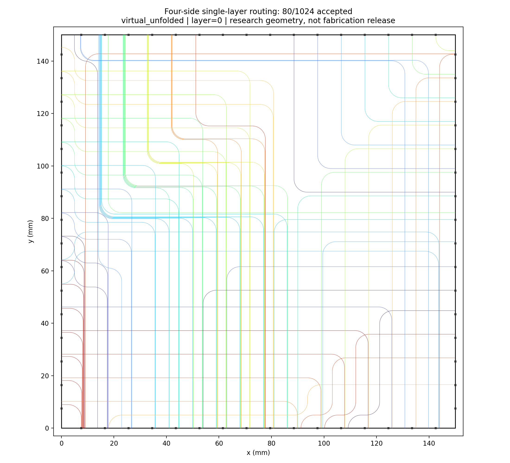

# 1024 四边单层实验与复现

当前选定算法为原逆向 AutoRouter 的四边适配版，入口 `legacy_adapter.py`。邻边保留固定 L 形／三弯模板；两个跨边分支分别按源边调用；每条路线的 256 次评价上限已取消，仅保留全局时间和评价预算。原 256/512 路由核心未改动。

## D56 优化版：467/1024（2026-10-19）

在**不改变 D56 弯曲几何**（正交直线 + 固定 R = 5 mm 圆弧 + 原 AutoRouter 小位移短 S 公式）、
不改变连接关系/端点/板面/单层约束的前提下，新引擎把布通数从 80 条提升到 **467/1024（45.61%）**：
对边 53 / 邻边 414，平均长度 149.56 mm，同层交叉 57029（小于 10° 仅 9 个），
独立校验 0 间距 / 0 重叠 / 0 半径 / 0 板界 / 0 斜线违规。
核心改进：① 修正交叉区计算（历史 `clearance/sin(angle)` 公式对"圆弧参与交叉"欠豁免
4.9 nm ~ 51 µm，实测 96.9% 的历史 spacing 拒绝是数值假冲突，这是原版 80 条的主因）；
② 采用"邻边优先"的布线顺序（D56 下邻边是刚性单 L，必须先布；对边优先只有 358 条）；
③ U/Z/L/Z3 正交候选族 + 由实际障碍带推导车道 + 事务式拆线重布（本实例净增 0，属阴性结果）。

| 方案 | 布通 | 对边/邻边 | 说明 |
|---|---:|---:|---|
| Legacy 80 | 80 | 24/56 | 历史四边适配器（600 s 预算） |
| **D56 Optimized（本轮）** | **467** | **53/414** | 精确交叉区口径，R=5 mm 未改 |
| D56 Optimized（历史口径对照） | 72 | 10/62 | 同算法换回历史交叉窗 |
| General 526（历史参考） | 526 | 490/36 | 自由曲线/Dubins，非 D56 几何 |

入口：代码 `four_side_1024/d56/`（SPEC、候选族、精确冲突索引、调度与拆线重布、独立校验器、
产物管线、pytest 套件）；[完整实验报告](../../docs/reports/four_side_1024_d56_optimized.md)；
[失败诊断报告](../../docs/reports/d56_1024_failure_diagnosis.md)；
[产物目录](../outputs/four_side_1024_d56_optimized/)（13 个必需文件 + 独立审计 + 消融表）。

```shell
# 重新寻路（最佳顺序，约 3 分钟）
python -m four_side_1024.d56.run --strategy A --groups NW,EN,SW,ES,NS,EW --within x_desc --out outputs/four_side_1024_d56_optimized

# 独立验收（精确主口径 + 历史口径敏感性）
python -m four_side_1024.d56.validate_d56 --routes outputs/four_side_1024_d56_optimized/routes.json --compare-exact

# 产物生成与测试
python -m four_side_1024.d56.outputs_d56 --run-dir outputs/four_side_1024_d56_optimized --run-status complete
python -m pytest four_side_1024/d56/tests_d56 -q
```

> 说明：本轮主结果采用"精确交叉区边界"口径（对"交叉只豁免局部区域"的精确实现），
> 半径、宽度、间距、层、端点均未改变；历史 `clearance/sin(angle)` 口径只作敏感性对照
> （同算法 72/1024，8919 对 ≤51 µm 的数值短差）。详见完整报告第 5 节。

## ABCD 四算法对照与 FSLW 双高度 2x16 实验（2026-10-19 晚）

| 轮次 | 模型与参数 | 实验 | 最佳结果 |
|---|---|---|---:|
| ABCD | 单层虚拟展开（32 端口 0.175 mm 展开），R = 5 mm、边缘间距 125 um | V1/V2 x A/B/C/D，8 组全量 1024 | **V1_B 462/1024** |
| FSLW | 双高度真实 2x16（row1->z1、row2->z2），R >= 40 mm（固定 40）、边缘间距 30 um | 16 个平面 + 8 个组合布局 + 4 配置敏感性 | **V2_C 694/1024** |

两轮都使用统一的 `strict` 局部交叉窗口验收（只有交叉点附近的精确最小必要窗口豁免间距，
窗外双向严格复检），并由独立校验器与路由器索引双实现交叉验证（mismatch = 0）。

FSLW 轮的三个硬结论：① 邻边平面（z2）有 22.3 %（V1）/25.0 %（V2）连接在 R=40 固定弧下
**几何上无合法路径**，z2 上限 = 398/384 每 512；② 半径决定"路径族是否存在"，间距决定
"能塞多少车道"（敏感性 O/G/R/N：z1 266/423/306/367，z2 480/512/177/186）；
③ 单层平面交叉数极大（每平面数万次，含数百个 <10 度浅角交叉），但交叉/弯曲损耗未知，
报告中不使用任何未标定的损耗数值。**双高度模型是仿真假设：玻璃厚度与接头安装方向未确认、
9 mm 接头间距存在机械干涉、未实现 z 过渡，不宣称可制造。**

入口：代码 `four_side_1024/abcd/` 与 `four_side_1024/fslw/`；
报告 `docs/reports/four_side_1024_v1_v2_abcd.md`、
`docs/reports/four_side_1024_fslw_R40_gap30_abcd.md`；产物目录
`outputs/four_side_1024_v1_v2_abcd/`、`outputs/four_side_1024_fslw_R40_gap30_abcd/`。

## V3-Huang 同边 U 型/回折拓扑：473/1024（2026-10-19）

用户提供的 V3-Huang 1024 通道连接（**same 448** / opposite 384 / adjacent 192）在双高度真实
2×16 接口、**R ≥ 40 mm 固定**、边缘间距 30 µm 下完成 8 个平面实验 + 4 套组合布局：
A 455、B **473（最佳，46.19 %）**、C 465、D 430 /1024。8/8 平面通过独立 strict 审计
（0 违规、160 367 对路线 mismatch=0）。同边布通 203/448（B，NN 在 z1 达 54/56），
但对边从 A 的 346/384 降到 221/384：**规整 U 型轨道是零和再分配**。几何要点：普通 U 需
横向 ≥2R=80 mm，仅 53/448 同边连接可用；395 条需短 S+180° 回折（回路高 40–120 mm）；
单边隔离布通 ≈95 % 而四边同平面 ≈45 %——同边损失来自大回路互斥与禁止二次交叉的 strict
政策，不是候选不足。同边候选库为本轮扩展，V1/V2 对比仅描述性（报告 §9.5）。
入口：`v3/`；报告 `docs/reports/four_side_1024_v3_huang_R40_gap30_abcd.md`；
产物 `outputs/four_side_1024_v3_huang_R40_gap30_abcd/`。

## 最新实测：two_branch_v2

| 项目 | 结果 |
|---|---:|
| 原始连接 / 端点 / 接头 | 1024 / 2048 / 64 |
| 通过最终几何检查 | 80 / 1024（7.8125%） |
| 实际进入轨道与几何处理 | 667 |
| 当前固定轨道内未找到合法路径 | 586 |
| 处理中因总时间结束而停止 | 1 |
| 因总时间结束而尚未开始 | 357 |
| 同层交叉 / 小于10°交叉 | 1141 / 0 |
| 路由层 / 最小半径 | layer=0 / 5 mm |
| 总程序执行时间 | 602.117 秒 |
| 路由时间 / 总评价预算 | 600 秒 / 900000 次 |
| 实际几何评价次数 | 429559 |

未完成944条不能统一解释为“几何不可能布通”。用尽的是时间预算，未达到总评价次数上限。运行结果受机器速度影响，这里保存的是一次真实运行快照。



完整的 [实验报告](../../docs/reports/four_side_1024_legacy_two_branch_v2.md)、[统计JSON](../outputs/four_side_1024_legacy_two_branch_v2/statistics.json)、[失败记录](../outputs/four_side_1024_legacy_two_branch_v2/failed_routes.json)、[SVG](../outputs/four_side_1024_legacy_two_branch_v2/routing_all.svg)、[GDS](../outputs/four_side_1024_legacy_two_branch_v2/routing_all.gds) 与 [独立验收](../outputs/four_side_1024_legacy_two_branch_v2/independent_audit.json) 均已保留。全部GDS路径属于layer=0。

## 输入与物理局限

输入文件为 [`data/optical_1024_multitomulti_connectivity_v1.csv`](../data/optical_1024_multitomulti_connectivity_v1.csv)，内容与用户原文件逐字节相同：

```text
SHA256 0ecce47109f9223e8407928c423ad5d9272186938cc267877a6158936e0e428b
```

row=1/row=2是接头内部两排通道，两者共同参与同层冲突检测。真实端口面采用0.25 mm列距与0.50 mm排距；实验中的二维端点采用明确标注的 `virtual_unfolded` 坐标，未验证真实端口到平面的适配器。9 mm接头中心距为暂定值；完整MPO外壳按标准所述宽度沿板边安装时存在机械重叠。半径5 mm、宽度0.05 mm、边缘间距0.125 mm是初版验证参数，不是新玻璃工艺最终标准。旧聚合物损耗模型仅为估计对照。

## 运行

先按项目主README安装依赖，然后在 `OpticalWaveguideRouter2D` 目录执行：

```shell
# 仅读取、校验并保存1024条输入，不执行布线
python -m four_side_1024.legacy_adapter

# 一次固定参数的布线运行
python -m four_side_1024.legacy_adapter --route --seconds 600 --evaluations 900000 --output outputs/four_side_1024_legacy_two_branch_v2

# 对保存的几何、交叉与GDS执行独立验收
python -m four_side_1024.independent_audit --output outputs/four_side_1024_legacy_two_branch_v2
```

程序优先读取仓库内的CSV；在原开发环境中没有打包CSV时，可回退至原桌面路径，也可用 `--input` 显式指定。发布时仅增加了默认输入的可移植查找，不改变路由算法。实验JSON/log中的绝对路径是原运行记录；各实验的 `source_manifest.json` 是当时源码快照的哈希，不代表当前发布文件必须与历史源码完全相同。

## 历史结果

- `four_side_1024_single_layer_v1`：之前的通用候选搜索对照实验，526条，不是当前选定的原算法入口。
- `four_side_1024_legacy_single_layer_v1`：修改前66条；含已停止运行的标记和更早预算试跑归档。
- `four_side_1024_legacy_input_v1`：当前输入接入与代码测试记录。
- `four_side_1024_legacy_two_branch_v2`：本页所述最新80条结果。

历史实验完整保留以便追溯，不能把不同算法或不同预算版本的数字混用。缓存、虚拟环境和旧256/512私有输入不属于本次发布文件。

## 2026-10-20 更新：V2 候选扩展 / 纯正交 90° / 五层 2.5D

| 轮次 | 结果 | 报告 | 产物 |
|---|---:|---|---|
| V2 双高度候选扩展 + 强化 R&R | 752/1024（73.44%） | [报告](../../../docs/reports/four_side_1024_v2_candidate_rr_v01.md) | [目录](../outputs/four_side_1024_v2_candidate_rr_v01/) |
| 纯正交 90° 圆弧对照 | 262/1024（25.59%） | [报告](../../../docs/reports/four_side_1024_v2_ortho90_v01.md) | [目录](../outputs/four_side_1024_v2_ortho90_v01/) |
| 五层 2.5D 局部抬升（A） | 820/1024（80.08%；3 层 788） | [报告](../../../docs/reports/four_side_1024_v2_25d_v01.md) | [目录](../outputs/four_side_1024_v2_25d_v01/) |
| 五层 2.5D 局部抬升（B） | 383/1024（37.40%；3 层 342） | 同上 | 同上 |

- 上述结果全部通过独立 strict / 独立三维验收（0 违规）；2.5D 轮次额外检查完整三维最小曲率
  半径 >= 40 mm、端口切向与真三维净空 >= 0.08 mm。
- 2.5D 模型只允许"单次升降"（接口层 -> 中间层 -> 接口层），不包含 Native 3D 联合寻路；
  双高度接口、R=40 mm、30 um 边缘间距等物理参数沿用 FSLW 轮，不宣称可制造。
- 复现命令见各产物目录的 `REPRODUCE.md` / `REPRODUCE_25D.md`。

## 2026-10-20 更新：R15 轮（全部弯曲 R = 15 mm）

| 轮次 | R40 历史 | R15 本轮 | Δ | 报告 | 产物 |
|---|---:|---:|---:|---|---|
| 二维 D56（Short-S） | 752 | **943**（92.09%） | +191 | [报告](../../../docs/reports/four_side_1024_v2_r15_v01.md) | [目录](../outputs/four_side_1024_v2_r15_v01/) |
| 二维纯正交 90° | 262 | **515**（50.29%） | +253 | 同上 | 同上 |
| 五层 2.5D + Short-S | 820 | **985**（96.19%） | +165 | 同上 | 同上 |
| 五层 2.5D + 纯正交 | 383 | **723**（70.61%） | +340 | 同上 | 同上 |

- 工艺要求：所有平面弯曲与 3D 升降弯曲固定 R = 15 mm（优先于历史 R40 与 PDF 示例
  R6000/6137.33 µm）；五层高度 z=[0,0.125,0.25,0.375,0.5] mm 仍是仿真假设，不是确认的
  工艺参数。
- 全部 8 项独立验收 PASS（10,046 条弧全部 R15、500 条 transition、0 违规）；
  最小 3D 净空 A 0.080295 mm、B 0.080000 mm（恰在冻结 strict 容差边界内，制造前需复核）。
- R40 全部历史结果保留，两轮数字不混用；本轮只做单次升降 2.5D，不含 Native 3D 联合寻路；
  损耗系数待标定，不输出总损耗结论。复现命令见
  `outputs/four_side_1024_v2_r15_v01/REPRODUCE_R15.md`。

## 2026-10-20 更新（R9）：L1–L5 物理模型纠错（探索性结果）

> **重要更正**：本文件上一条 2026-10-20 R15 更新中的“五层 2.5D + Short-S 985 / 纯正交 723”
> 以及更早的 R40 五层 820/383、3 层 788/342，均使用了错误的旧模型
> `z1=L1 / z2=L5` + 高度域 `[0,0.125,0.25,0.375,0.5]`，**不可作为五层结果继承或混用**，
> 仅保留为历史记录。正确模型：**L1 是接口层并同时包含 z1 排（z=0.0 mm）与
> z2 排（z=0.5 mm）两排端口**；L2–L5 为四个额外布线层，高度师兄尚未确认。

| 轮次 | 修正 L1 基线 | 主探索（medium_050） | 敏感性 compact/wide | 报告 | 产物 |
|---|---:|---:|---:|---|---|
| A（D56 + Short-S） | 943 | **963**（+20） | 962 / 963 | [报告](../../../docs/reports/four_side_1024_v2_l1l5_v01.md) | [目录](../outputs/four_side_1024_v2_l1l5_v01/) |
| B（纯正交 90°） | 515 | **621**（+106） | 611 / 611 | 同上 | 同上 |

- 修正模型允许任意层序与多次平滑升降（含 L1→L2→L3→L5→L1 等 4 次 transition 路径）；
  A/B 主探索分别有 24/31 条 ≥3-transition 路线。
- 8 项独立三维验收全部 `exploratory_only` PASS（0 违规；min 曲率 14.999999961 mm；
  min 真实 3D 净空 0.080000 mm；min transition-vs-flat 0.091540 mm；
  min transition-vs-transition 0.081738 mm）。
- **正式工艺验收未授予**：L2–L5 高度为 `unconfirmed_simulation`，`formal_acceptance=false`。
- 旧 R15 五层 985/723 / R40 五层 820/383 不可比；R15 二维 A 943 / B 515 作为修正 L1
  flat 基线重新在统一 3D 环境验收通过。
- 复现命令见 `outputs/four_side_1024_v2_l1l5_v01/REPRODUCE_L3D.md`；旧模型错误逐条审计见
  `four_side_1024/l3d/AUDIT_OLD_25D.md`。
