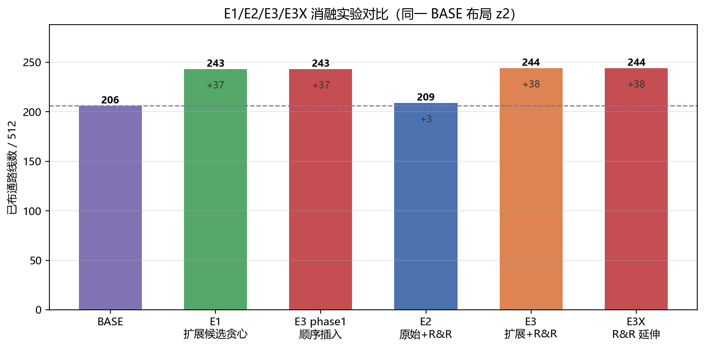
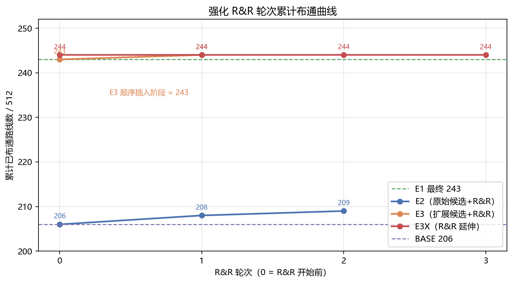
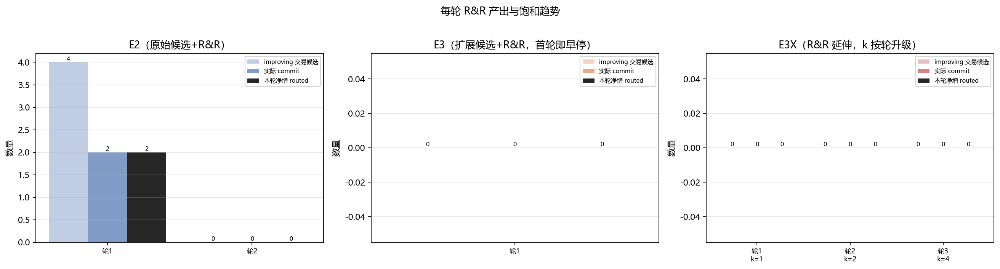
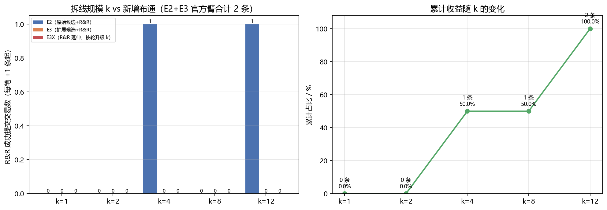
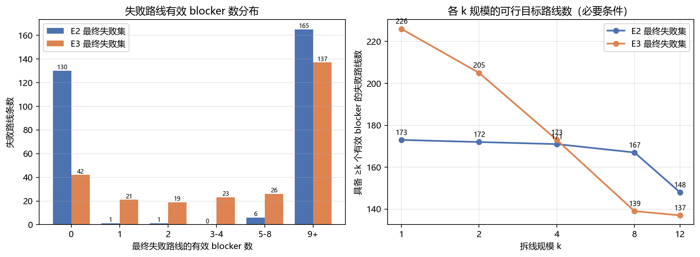
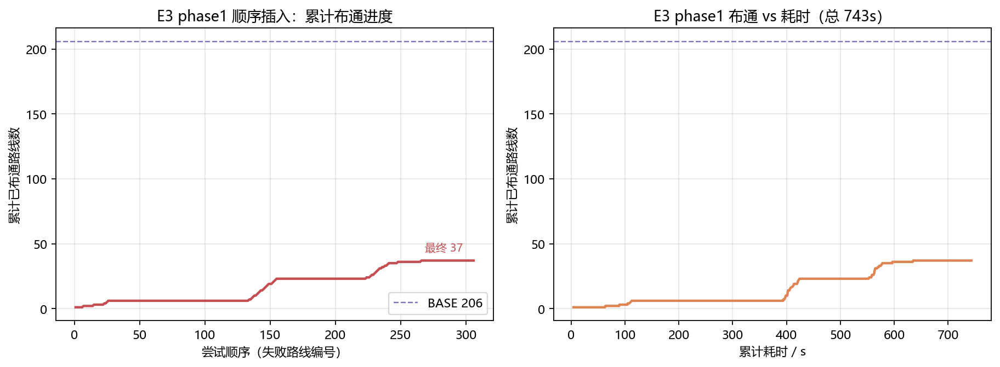
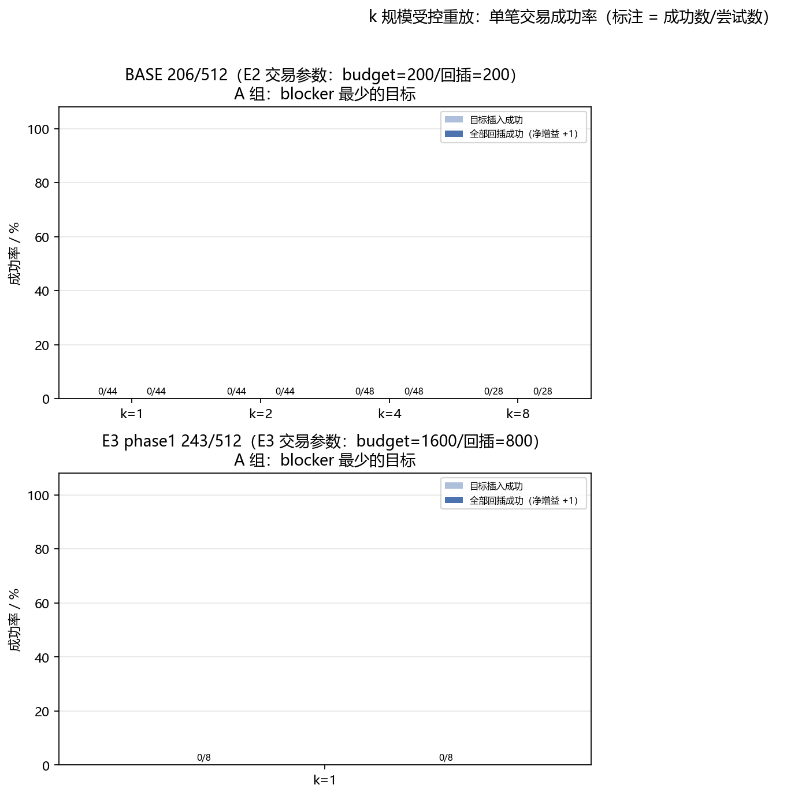

# V2 强化拆线重布（R&R）消融实验与拆线规模分析

**对象**：`OpticalWaveguideRouter2D` 四边单层 D56 布线，V2 平面 z2（512 条连接），BASE 布局 = 历史 V2-C（206/512）。
**任务**：任务 6（强化 R&R：blocker 重算、拆线规模 1/2/4/8/12、多插入顺序、并行 transaction、先重验后提交、严格 best-so-far）与任务 7（拆线规模收益分析）。
**数据来源**：全部来自 `four_side_1024.v2opt.pipeline` 的真实运行产物（`planes/V2/{E2,E3,E3X}/z2`、`experiments/*_summary.json`、`work/*.log`、`checkpoints/*`），由 `four_side_1024/v2opt/rr_analysis.py` 自动提取，未手改任何数字。分析脚本同时做「日志 ↔ summary」一致性校验（表 E，全部一致）。

> 口径说明：本文 `routed` 均为 z2 单平面已布通连接数（分母 512），strict / exact 交叉口径（`crossing_policy=strict`），未放松任何物理参数（宽度/间距/半径/层/端点）。

---

## 1. 摘要（结论先行）

| 问题 | 结论 |
|---|---|
| E2（原预算 200 + R&R） | 206 → **209**（+3，其中 R&R 交易 +2、blocker 分析直通 +1），2 轮后按「零增益轮」早停，267.7 s |
| E3（1600 预算顺序插入 + R&R） | 206 → 243（phase1 顺序插入 +37）→ **244**（R&R 贡献 +1，来自 blocker 分析直通；首轮 64 笔交易 improving=0），R&R 307.2 s 后早停 |
| E3 官方臂是否饱和 | **不能单独作为饱和证据**：只跑了 1 轮 R&R（零增益轮早停规则），`rr-time-limit=3600 s` 远未生效（实际 307 s）。真正强证据见 E3X |
| E3X（E3 续跑，R&R 搜索预算延伸） | 244 → **244（0 增益）**；共启动 4 轮（k=1:103 笔、k=2:66 笔、k=4:9 笔、k=8:0 笔），全程 improving=0 / committed=0，689.1 s、未触 1800 s 时限 → **z2 稠密布局上 R&R 已饱和**的关键证据 |
| 与 BASE 对比 | BASE 206 → E1 243（+37，贪心顺序插入）→ E3 244（+38）→ E3X 244；**R&R 在 E1/phase1 已铺满的低悬果子之上几乎无增益**（+1/+0） |
| 项目总口径（Lead finalize） | combined（z1+z2）BASE 698 / E1 735 / E2 701 / E3 736 / E3X 736 / Z1OPT 714 / **BEST = Z1OPT z1 508 + E3 z2 244 = 752/1024（73.44%）**，strict 审计 PASS |
| 拆线规模 k 收益 | 官方臂仅观测到 E2 的 2 笔成功交易（k=4、k=12 各 +1）；E3/E3X 在 k≤12 全部 0 增益。k 受控重放**部分完成**（见 §5.4，仅 A 组小样本，不得外推）|

---

## 2. 实验设置

| 实验 | 起点 | 候选生成器 / 预算 | R&R 参数 | 停止条件 | 产物 |
|---|---|---|---|---|---|
| BASE | 历史 V2-C | 历史运行（candidate_evaluations=38,013，320.8 s） | — | — | `planes/V2/BASE/z2/` |
| E1 | BASE 206 | expanded_v2opt / 1600 | 无 R&R，单趟贪心顺序提交 | 306 条全部尝试 | `planes/V2/E1/z2/`、`E1_z2_summary.json` |
| E2 | BASE 206 | original_round3 / 200 | budget=200、analysis=200、reinsert=200、sizes={1,2,4,8,12}、64 tx/轮、≤6 轮 | 零增益轮即停（实际 2 轮）；time-limit 1200 s 未生效 | `planes/V2/E2/z2/`、`E2_z2_summary.json` |
| E3 phase1 | BASE 206 | expanded_v2opt / 1600 顺序插入 306 条 | — | 306 条全部尝试（=E1 同配置，确定性复现） | `E3_phase1_summary.json`、`checkpoints/E3_phase1_z2.json` |
| E3 | phase1 243 | expanded_v2opt / 1600 | budget=1600、analysis=800、reinsert=800、sizes={1,2,4,8,12}、64 tx/轮、≤6 轮 | 零增益轮即停（实际 1 轮）；time-limit 3600 s 未生效 | `planes/V2/E3/z2/`、`E3_z2_summary.json` |
| E3X（延伸臂） | E3 checkpoint 244 | expanded_v2opt / 800 | budget=800、reinsert=600、analysis=800、64 targets/轮、**128 tx/轮**、**k 按轮升级 1→2→4→8→12**、**extras 机会插入（≤3 条/交易）**、min_rounds=5、连续 2 个零增益轮才停、seed_offset=777 | 无可用交易即退出（第 4 轮 k=8 时 0 笔交易）；time-limit 1800 s 未生效 | `planes/V2/E3X/z2/`、`E3X_z2_summary.json` |

R&R 交易语义（对 k 分析至关重要）：worker 在私有快照上先重插 target，再按选定顺序回插被拆的 k 条路线，最后尝试 extras；`net_gain = 最终已布通数 − 快照已布通数`。协调器对每条候选交易**先在当前布局上完整重验**，只有净增 >0 才提交，否则精确回滚（含 failed 表回滚，见 §10 代码版本说明）。E2/E3 官方实现中每个交易最多 +1（要求 k 条被拆路线全部回插成功）；E3X 的 extras 允许一次交易净增 >1。

---

## 3. 总览：最终 routed 与新增路线

| 实验 | R&R 前 routed | 最终 routed | 总增益 | 其中 R&R 交易提交 | 其中分析直通¹ | R&R / 总耗时 | 仍失败 |
|---|---:|---:|---:|---:|---:|---:|---:|
| BASE | – | 206 | – | – | – | 历史 320.8 s | 306 |
| E1 | – | **243** | +37 | – | – | 1,129.9 s（含机器争用） | 269 |
| E3 phase1 | 206 | 243 | +37 | – | – | 743.5 s | 269 |
| E2 | 206 | **209** | +3 | **+2** | +1 | R&R 267.7 s | 303 |
| E3 | 243 | **244** | +1 | +0 | +1 | R&R 307.2 s | 268 |
| E3X（延伸） | 244 | **244** | 0 | 0 | 0 | R&R 689.1 s | 268 |

¹ `analysis_placements = 最终 routed − 初始 routed − Σ(每轮 history.gain)`：R&R 每轮开始前的 `analyse_blockers` 阶段若发现某失败路线在当前布局下已可布通，会**直接布通并 +1**，该 +1 不计入 `history.gain`。E2 的该 +1 是路线 765（第 2 轮分析阶段），E3 的该 +1 是路线 528（第 1 轮分析阶段）；E3X 的四轮并行 blocker 分析均为 0 placed。

### 新增路线 ID 列表（相对 BASE 206）

- **E1 新增 37 条**：`513, 519, 527, 535, 537, 538, 741, 744, 745, 747, 749, 751, 752, 753, 756, 757, 758, 759, 761, 764, 765, 766, 767, 869, 875, 876, 878, 879, 880, 881, 882, 887, 890, 896, 897, 904, 922`
- **E2 新增 3 条**：`752, 765, 875` —— **全部包含于 E1 的 37 条内**（E1 未布通但 E2 独有的是 0 条）
- **E3 新增 38 条**：E1 的 37 条 + `528`（528 为 R&R 轮 1 分析直通）
- **E3X 新增 38 条**：与 E3 完全相同（相对 E3 净新增 **0** 条）
- 仍失败路线 ID 全集见各产物 `planes/V2/*/z2/failed_routes.json`（E2 303 条、E3/E3X 268 条），结构化列表同时保存在 `experiments/figures_rr/rr_analysis_data.json` 的 `e2.still_failed_ids` / `e3.still_failed_ids`。

E3 phase1 与 E1 是同一确定性配置：两者均为 243/512、`applied_route_ids` 完全相同（37 个 id 逐一一致），候选评价总数均为 **111,050**（E1 由 `planes/V2/E1/z2/config.json` 的 306 条 route_details 求和，E3 phase1 由 `E3_phase1_summary.json` 求和，二者相等）——这是「E1 = E3 phase1」的独立交叉验证。两者墙钟时间差异（1,129.9 s vs 743.5 s）来自当时机器负载不同，不代表算法快慢。

---

## 4. R&R 逐轮明细

### 4.1 E2（原始候选 + R&R；2 轮后早停）

| 轮 | 分析路线数 | transactions | improving | committed | 交易净增 | 分析直通 | 轮末 routed | 累计耗时 s |
|---|---:|---:|---:|---:|---:|---:|---:|---:|
| 1 | 96 | 64 | 4 | **2** | +2 | +0 | 208 | 150.4 |
| 2 | 96 | 64 | 0 | 0 | +0 | **+1** | 209 | 267.7 |

第 1 轮的两笔成功交易（日志原文）：`commit 875/k4: 206 → 207 (+1)`、`commit 752/k12: 207 → 208 (+1)`。第 2 轮 64 笔交易 improving=0 → 触发 `round_gain==0 → break`，R&R 结束；`rr-time-limit=2400 s` 未生效（实际 267.7 s）。

### 4.2 E3（扩展候选 + R&R；1 轮后早停）

| 轮 | 分析路线数 | transactions | improving | committed | 交易净增 | 分析直通 | 轮末 routed | 累计耗时 s |
|---|---:|---:|---:|---:|---:|---:|---:|---:|
| 1 | 96 | 64 | **0** | 0 | +0 | **+1**（路线 528） | 244 | 307.2 |

首轮 64 笔交易（sizes 混合 1/2/4/8/12，64 笔由 shuffle 后截断采样）**无一净增益**；243→244 的唯一 +1 来自分析阶段直接布通，不是交易提交。零增益轮立即早停，`rr-time-limit=3600 s` 未生效（实际 307.2 s）。

### 4.3 E3X（E3 续跑：k 按轮升级 + extras + 128 tx/轮；4 轮后无交易退出）

| 轮 | 本轮 k | 分析路线数 | transactions | improving | committed | 交易净增 | 分析直通 | 轮末 routed | 累计耗时 s |
|---|---:|---:|---:|---:|---:|---:|---:|---:|---:|
| 1 | 1 | 96 | **103** | 0 | 0 | +0 | +0 | 244 | 383.3 |
| 2 | 2 | 96 | **66** | 0 | 0 | +0 | +0 | 244 | 557.4 |
| 3 | 4 | 76 | **9** | 0 | 0 | +0 | +0 | 244 | 609.9 |
| 4 | 8 | 96 | **0** | 0 | 0 | +0 | +0 | 244 | 689.1（本轮分析 79.2 s 后无可用交易退出） |

- 事务数按 k 的分布 **103 → 66 → 9 → 0**，是核心证据：R&R 的目标选择按「当前有效 blocker 最少优先」，这些目标大多数只有 1–3 个有效 blocker，因此 k=2 之后可构造出的事务数迅速枯竭，k=8 一轮为 0 笔（`build_transactions` 对 blocker 数 <k 的目标返回空集），k=12 未启动。
- 4 轮并行 blocker 分析（96/96/76/96 条路线）**每轮 placed=0**：即「即使把该轮 96 条失败路线重新完整分析一遍，也没有一条能在当前布局直接布通」。
- E3X 总 R&R 689.1 s，`rr-time-limit=1800 s` 未生效，`min_rounds=5` 也因「无可用交易退出」而未达成 —— 因此 E3X 的 0 增益不是预算不足或轮数不足，而是**该布局下已构造不出净增益交易**。

---

## 5. 拆线规模 k 的收益

### 5.1 官方臂日志口径（每笔 committed 交易 = +1 条）

| k | E2 committed | E2 gain | E3 committed | E3 gain | 合计新增 |
|---:|---:|---:|---:|---:|---:|
| 1 | 0 | 0 | 0 | 0 | 0 |
| 2 | 0 | 0 | 0 | 0 | 0 |
| 4 | **1**（路线 875） | +1 | 0 | 0 | **1** |
| 8 | 0 | 0 | 0 | 0 | 0 |
| 12 | **1**（路线 752） | +1 | 0 | 0 | **1** |
| 合计 | 2 | +2 | 0 | 0 | **2** |

**这一口径的样本量极小（E2 2 笔、E3 0 笔），不能据此推断 k 收益的单调趋势**；但它给出两个可信事实：(a) k=4 与 k=12 各成功过一次，说明「k 较大」本身不必然失败（E2 布局较稀疏，206 已布通时平均有效 blocker 数 13.75）；(b) 同一套 sizes 在 E3 的稠密布局（243→244）上一笔也未成功。

注意事务提交的排序偏置：E2/E3 中 improving 结果按 `(-net_gain, -target_placed, size)` 排序，而全部 improving 的 net_gain 恒为 1、target 均 placed，因此同一轮内**小 k 交易先提交、大 k 交易后提交**；大 k 交易即使自身可行，也可能因前面提交改变了布局而在重验阶段被拒。k 归属因此对「小 k 有利」，不应把表 5.1 的 0/0 解释为「大 k 无效」。

旁证（Lead 最终报告 §5.5，从对侧 z1 平面日志直接统计，z1 基线 492，非同口径）：z1 的 R&R 交易为 k=1 成功 +7 条、k=2 +3 条、k=4 +2 条 —— 与 z2 的「几乎 0」形成对照，说明 **k 收益高度依赖平面结构性（z1 已布通 492/512 仍有 +12 交易收益；z2 的相邻边候选被大量路线阻挡、42 条几何无解）**，而不是 k 机制本身无效。

### 5.2 E3X 轮升级口径（每轮只用一个 k，128 tx/轮）

| k | 事务数（当轮） | improving | committed | 说明 |
|---:|---:|---:|---:|---|
| 1 | 103 | 0 | 0 | 含 extras 机会插入，仍 0 |
| 2 | 66 | 0 | 0 | 可构造目标减少 |
| 4 | 9 | 0 | 0 | 可构造目标几乎枯竭 |
| 8 | 0 | 0 | 0 | 无任何目标具备 ≥8 个有效 blocker，退出 |
| 12 | 未启动 | – | – | 上轮已无交易退出 |

该口径下 k 的「可尝试量」本身随 k 坍缩，是 R&R 在稠密布局饱和的直接机制：**不是大 k 尝试了但失败，而是连可尝试的交易都构造不出来**。

### 5.3 各 k 的可行目标域（最终失败路线的有效 blocker 数）

| 实验 | 最终失败数 | 平均有效 blocker | ≥1 | ≥2 | ≥4 | ≥8 | ≥12 |
|---|---:|---:|---:|---:|---:|---:|---:|
| E2 | 303 | 13.75 | 173 | 172 | 171 | 167 | 148 |
| E3/E3X | 268 | 46.55 | 226 | 205 | 173 | 139 | 137 |

E3/E3X 的失败路线平均被 46.55 条已布通路线阻挡（E2 为 13.75 条）；虽然 137 条最终失败路线具备 ≥12 个有效 blocker，但官方目标选择「blocker 最少优先」只会取其中最少者，导致大 k 交易几乎不可构造（§4.3、§5.2 已见）。此外 E3 phase1 有 **42 条路线生成 0 个候选**（`no_candidate_generated`，几何上无解，rip-up 不可能改变），这 42 条也构成 k=0 的天然下界。

### 5.4 受控 k 重放（诊断补充，独立于官方运行）**（部分完成）**

为弥补官方每轮只采样 64 笔导致的分母未知，`rr_analysis.py` 另做了**受控重放**：在冻结布局（BASE 206、E3 phase1 243）上，用发布版 `rr.build_transactions` 生成整轮**全部**交易（A 组 = blocker 最少的 N 个目标），以官方同 seed、同 budget/reinsert_budget/max_evals/transaction_seconds 逐笔执行 `rr.execute_transaction`，统计每 k 的目标插入成功率与「全部回插成功（净增益 +1）」成功率。该重放不改变任何共享模块，是只读诊断测量。

**受截止时间限制，重放只完成了「A 组（blocker 最少的目标）」的小样本子集，B 组（blocker 最多、覆盖大 k）未完成**；实际执行（真实数据，`experiments/figures_rr/rr_k_replay.json`）：

| 冻结布局 | 目标（A 组） | 执行交易数 | k | 尝试数 | 目标插入成功 | 全部回插成功（净 +1） | 平均候选评价 | 平均耗时 s |
|---|---|---:|---:|---:|---:|---:|---:|---:|
| BASE 206/512（E2 参数 budget=200/回插 200） | blocker 最少的 16 个（5–10 个 blocker） | 164 | 1 | 44 | 0 | 0 | 567 | 2.04 |
|  |  |  | 2 | 44 | 0 | 0 | 698 | 2.53 |
|  |  |  | 4 | 48 | 0 | 0 | 751 | 2.86 |
|  |  |  | 8 | 28 | 0 | 0 | 816 | 3.65 |
| E3 phase1 243/512（E3 参数 budget=1600/回插 800） | blocker 最少的 8 个（均为 1 个 blocker） | 8 | 1 | 8 | 0 | 0 | 74 | 6.39 |

可信的结论（受限于小样本）：
1. 在**冻结且未重新分析**的布局上，按历史失败记录里的 blocker 集执行拆线后，目标的候选插入成功率为 0%（BASE 164/164 与 E3 phase1 8/8 均未插入成功）。这说明「失败记录里的 blocker 集」只是**必要条件**：拆掉这些已记录的 blocker 之后，目标仍可能因其他几何/交叉约束而无法在预算内找到候选。官方 R&R 之所以能偶尔成功（E2 的 2 笔），依赖每轮先跑 `analyse_blockers` 把失败记录刷新到当前布局（E2 共重分析 192 条）。
2. 平均候选评价数随 k 上升（BASE：567 → 698 → 751 → 816），即大 k 交易更耗评价预算；E3 phase1 布局单笔交易平均 6.39 s（含 `adjacent_specs` 规格缓存构建开销）。
3. **本重放不能用来给出 k 的边际收益曲线**（样本小、且只覆盖 A 组、未模拟多轮提交与状态演化）；k 收益的正向证据仍以 E2 官方日志的 2 笔成功交易为准，负向/饱和证据以 E3/E3X 为准。B 组（大 k 覆盖）与更完整的 A 组重放属于未完成项，需后续补跑（命令：`python -m four_side_1024.v2opt.rr_analysis --k-replay --replay-plan "base:A48;e3phase1:A48,B16" --replay-workers 8`，当时单次约需 15–20 分钟）。

---

## 6. R&R 是否饱和？

1. **E2**：轮增益序列 2 → 0。第 2 轮 64 笔交易 improving=0 后立即早停；时间上限 1200 s 未触及（实际 267.7 s）。→ 在「原始候选 200 预算 + 206 布局」上，R&R 在 2 轮内即饱和。
2. **E3（官方臂）**：首轮 64 笔交易 improving=0 即早停；时间上限 3600 s 未触及（实际 307.2 s）。→ **仅能说明首轮无净增益交易，不能单独作为饱和证明**。
3. **E3X（延伸臂，关键证据）**：把轮数下限提到 5、k 逐轮放大到 8、事务/轮翻到 128、加入 extras 多路线机会插入之后，仍然是 **k=1/2/4 共 178 笔交易 improving=0，k=8 一轮构造出 0 笔交易**，4 轮分析 0 placed，总 689.1 s（远低于 1800 s 上限）。→ 在本 z2 稠密布局上，**强化 R&R 的可行域已被穷尽**；饱和不是「轮数/预算没给够」造成的。

饱和的结构性原因（由代码语义 + 实测数据共同支持）：
- 官方 R&R 的提交条件要求 `net_gain > 0`，而 target 必须插入，因此 E2/E3 中**净增益只能恰为 +1 且要求被拆的 k 条路线全部回插成功**；k 越大，回插全部成功的概率越低。
- E3 布局失败路线的有效 blocker 平均 46.55 条、且 42 条路线根本无候选；k≤12 的一次拆线远不足以让目标进入可布通状态。
- E3X 的 extras 机制放宽了「必须全部回插」的限制，但仍不够；目标选择（blocker 最少优先）进一步使大 k 无目标可用。

---

## 7. 耗时与候选评价

| 实验 | 候选评价总数 | 耗时 | 备注 |
|---|---:|---:|---|
| BASE（历史） | 38,013 | 320.8 s | 历史运行记录 |
| E1 | **111,050** | 1,129.9 s | 306 条顺序插入（当时机器争用严重） |
| E3 phase1 | **111,050** | 743.5 s | 与 E1 同配置同结果；平均 2.43 s/路线、最长 15.66 s、42 条 0 候选；平均 362.9 次评价/路线、最大 1600 |
| E2 R&R | 未落盘¹ | 267.7 s | 2 轮；每轮 96 条 blocker 分析（analysis_budget=200）+ 64 笔交易（budget=200、reinsert=200） |
| E3 R&R | 未落盘¹ | 307.2 s | 1 轮；96 条 blocker 分析（budget=800）+ 64 笔交易（budget=1600、reinsert=800） |
| E3X R&R | 未落盘¹ | 689.1 s | 4 轮分析（96/96/76/96，budget=800）+ 103/66/9/0 笔交易（budget=800、reinsert=600、extras≤3） |

¹ R&R 的 `execute_transaction` 会返回 `evals`，但 `rr.py` 的协调器未把每笔交易的评价数写入日志/summary/checkpoint，因此 R&R 的候选评价总数**无法从现有产物取得**（本文不估算、不编造）。可给出的上界/参数：每笔交易受 `max_evals_per_transaction=12000` 与 `transaction_seconds=90 s` 约束；E2 每笔交易最坏 (1+k)·200 次、E3 最坏 1600+12·800=11,200 次（<12,000，未触上限）、E3X 最坏 800+12·600+3·800=10,400 次（<12,000）。

墙钟对比注意：E1 与 E3 phase1 是**同一确定性工作**（结果、评价数完全相同），墙钟 1,129.9 s vs 743.5 s 的差异完全来自运行时机器负载，不应作为算法效率结论。

---

## 8. 与 BASE / E1 / Z1OPT / 项目总口径对比

### 8.1 z2 单平面

| 方案 | routed/512 | 相对 BASE | 说明 |
|---|---:|---:|---|
| BASE（历史 V2-C） | 206 | – | by_pair：EN 64 / ES 37 / SW 43 / NW 62 |
| E2（原预算+R&R） | 209 | +3 | by_pair：EN 64 / ES 39 / SW 44 / NW 62 |
| E1（扩展候选贪心） | 243 | +37 | by_pair：EN 70 / ES 54 / SW 54 / NW 65 |
| E3（扩展候选+R&R） | 244 | +38 | by_pair：EN 71 / ES 54 / SW 54 / NW 65 |
| E3X（R&R 延伸） | 244 | +38 | 0 增益 |
| **z2 最优** | **E3 = 244** | +38 | 相对 E1 仅 +1（且来自分析直通而非交易） |

新增路线集合关系（表 G）：E2 的 3 条全部 ⊂ E1 的 37 条；E3 的 38 条 = E1 的 37 条 + `528`；E3X 与 E3 完全相同。即**扩展候选贪心（E1/E3 phase1）已经拿到几乎全部可布通路线，R&R 只补到 1 条**。

### 8.2 项目总口径（z1+z2 = 1024，Lead finalize 独立 strict 审计 PASS）

| 标签 | combined routed/1024 | 来源 |
|---|---:|---|
| BASE | 698 | z1 492 + z2 206 |
| E1 | 735 | 492 + 243 |
| E2 | 701 | 492 + 209 |
| E3 | 736 | 492 + 244 |
| E3X | 736 | 492 + 244 |
| Z1OPT | 714 | z1 508 + 206 |
| **BEST** | **752（73.44%）** | Z1OPT z1 508 + E3 z2 244 = 698 基线 **+54** |

Z1OPT（z1 平面，基线 492，非同口径，仅作旁证）：492 → 508（+16）= 顺序插入 3 条（20 条尝试、47.3 s）+ R&R 13 条（3 轮、107.3 s，各轮 gain 8/4/0）。与 z2 形成对比：**z1 的 R&R 在 492/512 的高密度下仍能拿到 +13，说明 R&R 本身有效**；z2 的 0 增益来自 z2 布局/候选生成器的具体结构（相邻边候选被大量路线阻挡、且 42 条几何无解），而不是 R&R 机制失效。

---

## 9. 结论

1. **消融顺序清楚**：BASE 206 → 扩展候选贪心 E1/E3 phase1 243（+37，主收益来源）→ R&R 官方臂仅 +1（E3 244）→ R&R 延伸臂 E3X +0（244）。z2 的最终最优 = **244/512**。
2. **强化 R&R 在 z2 已饱和**：E3X 用 4 轮、178 笔可构造交易、k 升级 1→2→4→8、extras 机制与 689 s 预算验证了 zero gain；事务数随 k 坍缩（103/66/9/0）与每轮分析 0 placed 是最直接证据。E3 官方臂的 244 是「首轮零增益早停」结果，不能单独当作饱和证据。
3. **拆线规模 k 的收益有限且高度依赖布局**：官方臂仅 2 笔成功交易（k=4、k=12，均在 E2 的 206 稀疏布局）；E3/E3X 在 k≤12 全部 0 增益；机制上 k 越大越要求「全部回插成功」，且稠密布局下可构造的大 k 交易数很快枯竭（k=8 时为 0 笔）。
4. **代价对比**：R&R 官方臂额外耗时 268 s（E2）/307 s（E3）、延伸臂 689 s，收益 +2/+0/+0；对比 E1/E3 phase1 顺序插入 743–1130 s 换 +37，**R&R 在本问题的性价比明显更低**。
5. 项目层面仍由 E3（z2 244）+ Z1OPT（z1 508）组成 BEST 752/1024（73.44%），strict 审计 PASS。

---

## 10. 不确定性与局限

1. **单 seed、单次运行**：E2/E3/E3X 各只跑了一次（seed=20261019 / 2026 1796 系列偏移），未做多 seed 复现；R&R 的随机性（交易构造、顺序采样）可能导致 ±1~2 条波动。
2. **k 归属样本极小**：官方臂日志只能看到「已提交交易」的 k（E2 共 2 笔、E3 0 笔），看不到未成功交易的分母与失败原因，因此 §5.1 的 k 表**不能用于推断 k 的边际收益曲线**；§5.4 的受控重放因截止时间只完成 A 组小样本（BASE 164 笔、E3 phase1 8 笔），B 组（blocker 最多、覆盖大 k）与完整 48 目标重放**未完成**，不能替代完整 k 曲线。
3. **E3 官方臂的早停**：`round_gain==0 → break` 的规则使 E3 只尝试了 1 轮 64 笔交易；E3X 已用更宽松规则（min_rounds、k 升级、128 tx/轮）验证了饱和，但两者的参数与代码版本不同（E3X 使用事件后改进的 rr.py），不能参数级直接对比。
4. **E3X 代码版本**：E3X 运行于 Lead 后续改进的 `rr.py`（并行 blocker 分析、按轮升级 k、extras、放宽早停），与 E2/E3 官方臂的实现不同；E3X 只作为「搜索预算延伸」证据，不与官方臂做同参数消融解读。
5. **blocker 数据新鲜度**：E2 的失败记录中 192/306 条在本轮被重新分析（每轮 96 条），其余沿用历史 C 运行的 blocker 记录；E3 phase1 顺序提交时刷新了全部 306 条；E3/E3X 的 R&R 又各自重新分析 96 条/轮。§5.3 的有效 blocker 统计是「最终状态下的最后一次记录」，不是运行中每轮的实时值。
6. **候选评价数缺失**：R&R 每笔交易的候选评价数未落盘（见 §7 脚注），因此无法给出 R&R 的「每新增 1 条路线耗费的候选评价数」这一效率指标。
7. **墙钟不可比**：E1/E3/E3X 运行期间机器上并行跑着其他实验（sweep/finalize 等），墙钟时间受负载影响；同配置的 E1 1129.9 s 与 E3 phase1 743.5 s 即为证据。只有候选评价数与事务数是不受负载影响的确定性计数。
8. **物理口径**：本文所有数字均为 strict / exact 计数口径的**布通条数**，没有放松任何宽度/间距/半径/层/端点参数；未做光学校验（弯曲/交叉损耗未标定，见 BASE statistics 的 `bend_loss`/`crossing_loss: unknown_uncalibrated`）。

---

## 11. 产物清单（绝对路径，均来自真实运行）

项目根：`C:\Users\lihao\Desktop\Graduation Project\OpticalWaveguideRouter2D`
产物根：`C:\Users\lihao\Desktop\Graduation Project\OpticalWaveguideRouter2D\outputs\four_side_1024_v2_candidate_rr_v01`

| 类别 | 路径 |
|---|---|
| 本文 | `outputs\four_side_1024_v2_candidate_rr_v01\experiments\ANALYSIS_RR.md` |
| 分析脚本 | `four_side_1024\v2opt\rr_analysis.py`（只读汇总 + 日志解析 + 受控 k 重放，`--k-replay`） |
| 数据 JSON | `outputs\four_side_1024_v2_candidate_rr_v01\experiments\figures_rr\rr_analysis_data.json` |
| 表格（md） | `outputs\four_side_1024_v2_candidate_rr_v01\experiments\figures_rr\rr_tables.md` |
| k 受控重放数据 | `outputs\four_side_1024_v2_candidate_rr_v01\experiments\figures_rr\rr_k_replay.json`（**部分完成**：BASE A16=164 笔 + E3 phase1 A8=8 笔） |
| E2 产物 | `outputs\...\planes\V2\E2\z2\`、`experiments\E2_z2_summary.json`、`checkpoints\E2_z2.json` |
| E3 产物 | `outputs\...\planes\V2\E3\z2\`、`experiments\E3_z2_summary.json`、`experiments\E3_phase1_summary.json`、`checkpoints\E3_z2.json`、`checkpoints\E3_phase1_z2.json` |
| E3X 产物 | `outputs\...\planes\V2\E3X\z2\`、`experiments\E3X_z2_summary.json`、`checkpoints\E3X_z2.json`、`work\rrcontinue_20261019_231611.log` |
| E1 产物 | `outputs\...\planes\V2\E1\z2\`、`experiments\E1_z2_summary.json` |
| 运行日志 | `outputs\...\work\e2_20261019_225302.log`、`e3_20261019_225301.log`、`e1_20261019_224325.log`、`rrcontinue_20261019_231611.log` |
| 图（PNG） | `outputs\...\experiments\figures_rr\`：`fig_experiment_compare.png`、`fig_rr_rounds_curve.png`、`fig_round_gain_saturation.png`、`fig_k_scale_gain.png`、`fig_k_availability.png`、`fig_e3_phase1_progress.png`、`fig_k_replay_yield.png`（部分完成） |

---

*生成方式：`four_side_1024/v2opt/rr_analysis.py` 从 summary/routes/checkpoint/log 自动提取并交叉校验；表中所有数字均可由 `experiments/figures_rr/rr_analysis_data.json` 与上述产物复算。*
